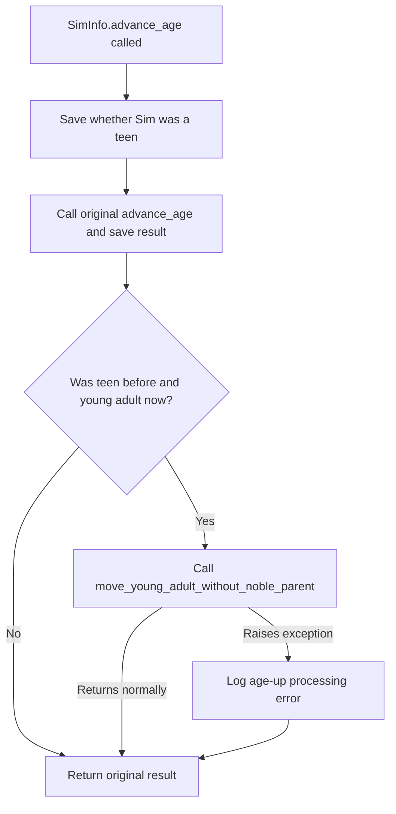

# Young Adult Age-Up Flow

These diagrams show the current flow from `SimInfo.advance_age` through
`_move_young_adult_after_age_up` and the household service it invokes.

```mermaid
flowchart TD
    A["move_young_adult_without_noble_parent called"] --> H{"Does Sim have a household?"}
    H -- No --> HF["Log household not found; return False"]
    H -- Yes --> I["Collect parent IDs and household Sim IDs"]
    I --> J["Check whether any in-household parent has a noble career"]
    J --> K{"Household manager available?"}
    K -- No --> KF["Notify manager unavailable; return False"]
    K -- Yes --> L["Check whether aged-up Sim has a noble career"]
    L --> M{"Noble parent present AND Sim has noble career?"}
    M -- Yes --> P["Keep Sim in current household and find a partner"]
    M -- No --> MH{"Is this the last human teen-or-older Sim in the household?"}
    MH -- Yes --> MHF["Notify Sim stays; return True"]
    MH -- No --> O{"Persistence and venue services available?"}
    O -- No --> OF["Notify service unavailable; return False"]
    O -- Yes --> Q{"Can current home zone determine its world?"}
    Q -- No --> QF["Notify current world unavailable; return False"]
    Q -- Yes --> R["Find vacant residential lots in that same world"]
    R --> R1{"Any vacant residential lots?"}
    R1 -- No --> R1F["Notify no vacant lot in same world; return False"]
    R1 -- Yes --> S["Choose a lot, create a household, and assign lot ownership"]
    S --> S1{"Household created?"}
    S1 -- No --> S1F["Notify household creation failed; return False"]
    S1 -- Yes --> T["Clear source lot if Sim is its sole occupant; transfer Sim"]
    T --> T1{"Transfer succeeded?"}
    T1 -- No --> T2["Clean up empty new household and restore source lot if cleared; notify error; return False"]
    T1 -- Yes --> U{"Noble parent present OR aged-up Sim has noble career?"}
    U -- No --> U1["Notify Sim moved to a same-world lot; return True"]
    U -- Yes --> P["Find a partner for Sim in the new household"]

    P --> P1{"Genealogy available for all ancestors?"}
    P1 -- No --> P1F["Notify genealogy unavailable; Sim remains in destination household; return True"]
    P1 -- Yes --> P2{"Does Sim already have a spouse?"}
    P2 -- Yes --> P2F["Notify Sim already has a partner; return True"]
    P2 -- No --> P3["Shuffle Sims and filter possible matches"]
    P3 --> P4["Candidate is different, housed elsewhere, young adult, different gender, single, and unrelated"]
    P4 --> P5{"Any eligible matches?"}
    P5 -- No --> P5F["Notify no match; Sim remains in destination household; return True"]
    P5 -- Yes --> P6["Choose a match; load marriage relationship and statistic tuning"]
    P6 --> P7{"All required tuning available?"}
    P7 -- No --> P7F["Notify tuning unavailable; return True"]
    P7 -- Yes --> P8{"Is the match's household their sole occupant?"}
    P8 -- Yes --> P9["Clear match household lot ownership"]
    P8 -- No --> P10["Transfer match into Sim's household"]
    P9 --> P10
    P10 --> P11{"Transfer succeeded?"}
    P11 -- No --> ERR["Handle as marriage/transfer error"]
    P11 -- Yes --> P12["Add married and has-met bits; set friendship and romance to 100; align last name"]
    P12 --> P13["Notify match moved in and married; return True"]
    ERR --> E1{"Was transfer completed before later failure?"}
    E1 -- Yes --> E2["Try moving match back; remove incomplete married bit"]
    E1 -- No --> E4["Notify error; return False"]
    E2 --> E3{"Original household lot cleared and match returned?"}
    E3 -- Yes --> E5["Restore original lot ownership"]
    E3 -- No --> E4
    E5 --> E4
```

Regardless of the household service's return value, the age-up wrapper returns
the result from the original `advance_age` call. Exceptions from household
processing that escape the service are logged and do not replace that original
result. The service's regular `True` or `False` return values do not affect the
age-up result.
