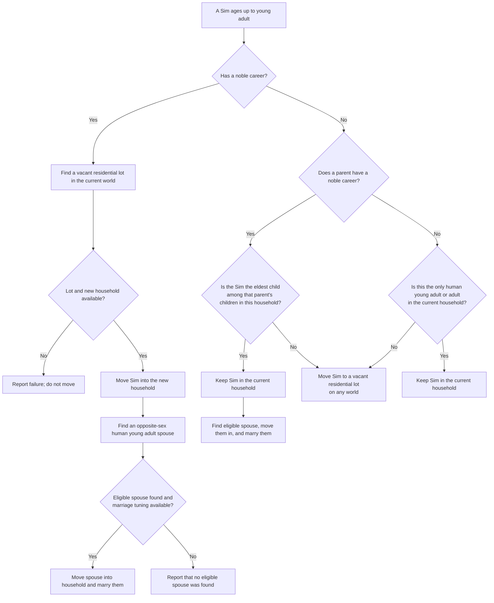

# Young Adult Age-Up Household Flow

`move_young_adult_without_noble_parent` processes the Sim after they age up to
young adult. Vacant lots are limited to residential lots. A spouse candidate
must be a human young adult of the opposite sex; an existing eligible spouse
is preferred, otherwise an eligible unmarried Sim who is not a parent, child,
or sibling is selected and married.

